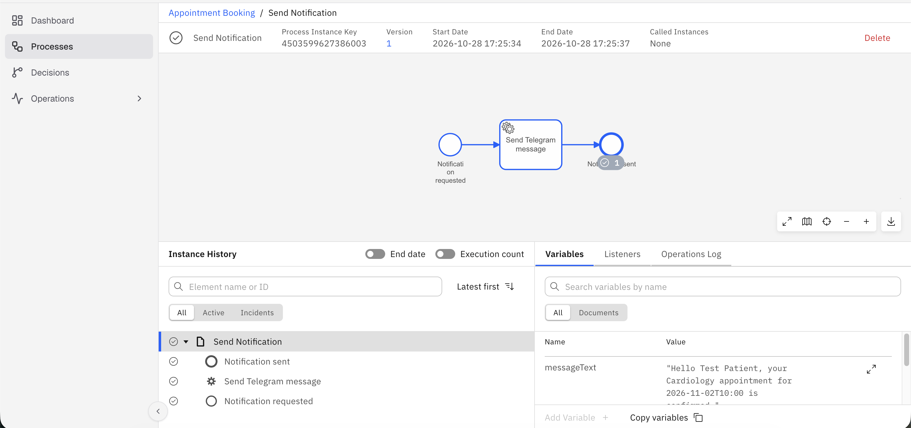
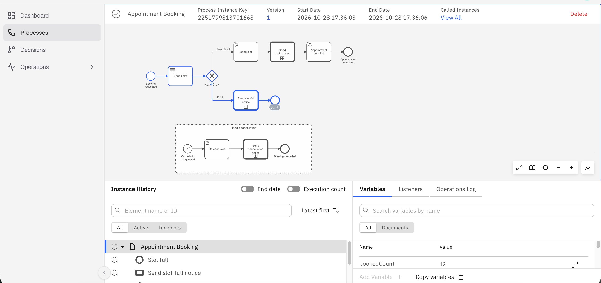

# Hospital Appointment Booking – Camunda 8

**Author:** Harish U  
Parent process + child process (call activity), DMN decision table, message-triggered cancellation subprocess.

## Files

| File | Purpose |
|---|---|
| `bpmn/appointment-booking.bpmn` | Parent process |
| `bpmn/appointment-booking-propagate-all.bpmn` | Same, propagation ON (comparison only) |
| `bpmn/send-notification.bpmn` | Child: Telegram notification via REST connector |
| `dmn/slot_decision.dmn` | Slot availability decision (UNIQUE hit policy) |
| `test-data/` | 3 test cases + cancellation message |

## Deploy & Test

1. Deploy: `slot_decision.dmn` → `send-notification.bpmn` → `appointment-booking.bpmn`
2. Add secret `TELEGRAM_BOT_TOKEN` in Console → Cluster → Connector Secrets
3. Set your Telegram chat ID as `patientId` in the test JSON files
4. Run test cases: TC1 (available), TC2 (full), TC3 (book then cancel)
5. Publish cancellation: `curl -X POST "$ZEEBE_REST/v2/messages/publication" -H "Content-Type: application/json" -d @test-data/cancel-message.json`

## Screenshots

